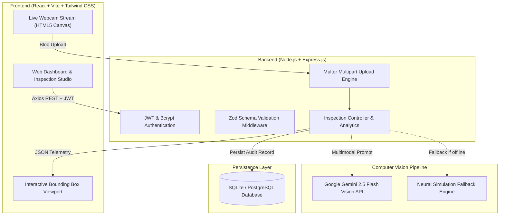

# QualiSight AI — Enterprise Visual Intelligence & Anomaly Detection Platform

[](https://react.dev/)
[](https://nodejs.org/)
[](https://aistudio.google.com/)
[](https://jwt.io/)
[](https://zod.dev/)
[](https://sqlite.org/)

> **Submission for Hackathon Theme: Computer Vision & Visual Intelligence**  
> An AI-powered Computer Vision solution that automates visual understanding, isolates defect anomalies with localized bounding regions, computes quality telemetry, and delivers actionable operational remediation insights.

---

## 📋 Table of Contents
1. [Problem Statement](#-problem-statement)
2. [Proposed Solution](#-proposed-solution)
3. [System Architecture](#-system-architecture)
4. [Assignment Tech Stack Compliance](#-assignment-tech-stack-compliance)
5. [Key Features](#-key-features)
6. [Repository Structure](#-repository-structure)
7. [Local Setup & Execution](#-local-setup--execution)
8. [API Reference](#-api-reference)
9. [Deployment](#-deployment)
10. [Submission Deliverables](#-submission-deliverables)

---

## 📌 Problem Statement

Modern manufacturing plants, electronics assembly facilities, logistics hubs, and safety-critical environments rely heavily on manual human inspection of components, camera feeds, and physical documentation.

- **Human Fatigue & Margin of Error:** Repetitive manual inspections result in a 20% to 30% miss rate for subtle structural fractures, micro-cracks, and tolerance shifts.
- **Throughput Delays:** Manual inspection slows production cycles and blocks dispatch logistics.
- **Absence of Traceable Telemetry:** Traditional checks lack standardized bounding coordinate capture, confidence metrics, and structured historical audit trails.

---

## 💡 Proposed Solution

**QualiSight AI** replaces manual inspection bottlenecks with an automated, high-precision visual intelligence pipeline:
- **Multimodal AI Analysis:** Leverages **Google Gemini 2.5 Flash Vision API** to examine images and camera frames for surface anomalies, assembly flaws, and safety non-compliance.
- **Visual Bounding Overlays:** Pinpoints anomalies using normalized coordinates `[ymin, xmin, ymax, xmax]`, rendering interactive overlays directly over inspected parts.
- **Quantitative Quality Metrics:** Computes overall Quality Scores (0–100), Defect Counts, and Risk Levels (LOW, MEDIUM, HIGH).
- **Actionable Remediation Directives:** Automatically generates concrete operational guidance (e.g. halt line segment, route to rework station, log QMS incident).
- **Fail-Safe Intelligent Simulation Mode:** Includes a high-fidelity simulation engine that activates automatically if an AI API key is not configured, guaranteeing flawless evaluation demonstrations.

---

## 🏗️ System Architecture



---

## 🛠️ Assignment Tech Stack Compliance

This application was engineered strictly adhering to all hackathon guidelines:

| Layer | Technology | Usage in Project |
| :--- | :--- | :--- |
| **Frontend** | React 19 + Vite | SPA architecture with blazing-fast HMR and bundling |
| **Routing** | React Router DOM v7 | Protected routes, dashboard, inspection studio, history |
| **Styling** | Tailwind CSS v4 | Enterprise dark theme, responsive grids, scanner animations |
| **Icons & UI** | Lucide React | High-contrast visual indicators and telemetry badges |
| **HTTP Client** | Axios | Interceptors for JWT authorization header management |
| **Backend** | Node.js + Express.js | RESTful modular micro-service architecture |
| **Auth** | JWT + bcryptjs | Salted password hashing (10 rounds) & 7-day token sessions |
| **Validation**| Zod | Strict schema validation for registration, login, and audits |
| **File Intake**| Multer | Secure disk storage and buffer extraction for image processing |
| **Database** | SQLite / PostgreSQL | Zero-config local SQLite + plug-and-play Supabase support |
| **Vision AI** | Google Gemini API | Multimodal prompt with structured JSON output schema |

---

## ✨ Key Features

1. **Live Camera Feed & Snapshot Capture:** Built-in webcam viewfinder with HUD reticle lock for immediate frame capture.
2. **Interactive Bounding Box Viewport:** Normalized 2D bounding boxes plotted directly over defects with confidence ratings.
3. **Specimen Presets:** 1-click loading of realistic test specimens (Surface Fracture Defect vs. Nominal PCB Pass) for instant testing.
4. **1-Click Instant Demo Login:** Special judge-access button on the login screen for frictionless evaluation.
5. **Comprehensive Telemetry & KPI Cards:** Real-time metrics for pass rates, anomaly counts, and average AI confidence.
6. **Audit Ledger & Filtering:** Search by keyword, filter by verdict (PASS / WARNING / FAIL) and category.
7. **Compliance Export:** Export structured JSON telemetry or print formal audit certificates.

---

## 📁 Repository Structure

```
qualisight-ai/
├── client/                     # React + Vite Frontend
│   ├── src/
│   │   ├── components/         # Navbar, MetricCard, WebcamCapture, InspectionViewer
│   │   ├── context/            # AuthContext (JWT management)
│   │   ├── pages/              # Login, Register, Dashboard, NewInspection, History
│   │   ├── services/           # Axios API service
│   │   ├── App.jsx             # React Router structure
│   │   └── main.jsx            # Entry point
│   ├── index.html
│   ├── package.json
│   └── vite.config.js
├── server/                     # Node.js + Express Backend
│   ├── config/                 # SQLite & Database helpers
│   ├── middleware/             # JWT auth, Multer upload, Zod validator
│   ├── routes/                 # Auth, Inspection, Analytics routes
│   ├── services/               # Gemini Vision AI service & Fallback engine
│   ├── uploads/                # Stored inspection images
│   ├── index.js                # Express entry point
│   ├── .env.example            # Environment template
│   └── package.json
├── DEPLOYMENT_GUIDE.md         # Step-by-step Vercel + Render deployment
├── DEMO_VIDEO_SCRIPT.md        # 3-5 minute video recording script
├── SUBMISSION_DOCS.md          # Problem Statement & Solution Description
├── test_e2e.mjs                # Automated end-to-end test verification script
└── package.json                # Root monorepo script runner
```

---

## ⚡ Local Setup & Execution

### 1. Prerequisites
- Node.js (v18 or higher)
- npm (v9 or higher)

### 2. Clone and Install Dependencies
```bash
git clone https://github.com/<your-username>/qualisight-ai.git
cd qualisight-ai

# Install backend dependencies
cd server
npm install

# Install frontend dependencies
cd ../client
npm install
```

### 3. Configure Environment Variables
Inside the `server/` directory:
```bash
cp .env.example .env
```
Edit `server/.env`:
```env
PORT=5000
JWT_SECRET=your_jwt_secret_key_here
# Optional: Set your Gemini key for live Gemini 2.5 Flash Vision calls.
# If omitted, the platform runs in high-fidelity simulation mode.
GEMINI_API_KEY=
SQLITE_DB_PATH=./database.sqlite
```

### 4. Run the Application
Open two terminal windows:

**Terminal 1 (Backend Server):**
```bash
cd server
npm run dev
# Server runs on http://localhost:5000
```

**Terminal 2 (Frontend Client):**
```bash
cd client
npm run dev
# Client runs on http://localhost:3000
```

### 5. Instant Test / Judge Evaluation
1. Open `http://localhost:3000` in your browser.
2. Click **"1-Click Instant Demo Access"** on the login screen.
3. Click **"New Visual Inspection"**.
4. Click **"🔴 Load Defect Specimen (Fracture)"** and then **"Execute AI Visual Inspection"**.
5. Observe the live bounding boxes, severity rating, and remediation steps!

---

## 🔌 API Reference

| Method | Endpoint | Protection | Description |
| :--- | :--- | :--- | :--- |
| `GET` | `/api/health` | Public | System status and active AI engine |
| `POST` | `/api/auth/register` | Public (Zod) | Registers new inspector account |
| `POST` | `/api/auth/login` | Public (Zod) | Validates credentials & issues JWT |
| `GET` | `/api/auth/me` | JWT Bearer | Retrieves authenticated profile |
| `POST` | `/api/inspect/analyze`| JWT Bearer | Uploads image & runs Vision AI analysis |
| `GET` | `/api/inspect/history`| JWT Bearer | Fetches paginated inspection history |
| `GET` | `/api/inspect/:id` | JWT Bearer | Retrieves single inspection audit report |
| `DELETE`| `/api/inspect/:id` | JWT Bearer | Removes an inspection audit record |
| `GET` | `/api/analytics/summary`| JWT Bearer | Returns KPI statistics and pass rate % |

---

## 🚀 Deployment

- **Frontend:** Deployed on **Vercel** (`VITE_API_URL` pointing to backend).
- **Backend:** Deployed on **Render** (as a Web Service running `node index.js`).
- Detailed deployment instructions with screenshots are available in [DEPLOYMENT_GUIDE.md](./DEPLOYMENT_GUIDE.md).

---

## 📄 Submission Deliverables

- [x] **Problem Statement:** Detailed in [SUBMISSION_DOCS.md](./SUBMISSION_DOCS.md).
- [x] **Solution Description:** Outlined in [SUBMISSION_DOCS.md](./SUBMISSION_DOCS.md).
- [x] **Public GitHub Repository:** Clean source code with monorepo setup.
- [x] **Deployed Application Guide:** Documented in [DEPLOYMENT_GUIDE.md](./DEPLOYMENT_GUIDE.md).
- [x] **Demo Video Script (3–5 min):** Complete word-for-word script in [DEMO_VIDEO_SCRIPT.md](./DEMO_VIDEO_SCRIPT.md).
